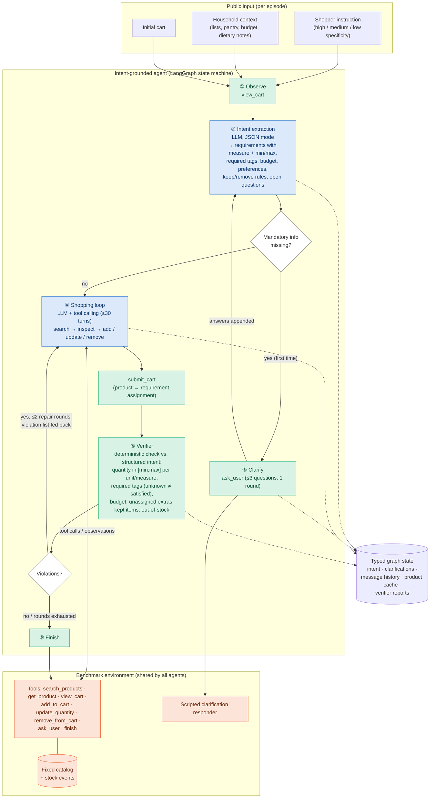

# Agent architecture (draft figure source)

Draft source for the paper's architecture figure. GitHub renders the Mermaid
block below; it can also be pasted into https://mermaid.live to export PNG/SVG,
or redrawn in draw.io / TikZ. Everything here matches the code in
`src/grocery_agent/llm_agents.py` (graph) and `src/grocery_agent/prompts.py` (prompts).

Legend: **blue = LLM call**, **green = deterministic code**, **orange = benchmark tools / environment**.

## Main diagram



## Plain-text fallback

```
 instruction + household context + initial cart
                     |
                     v
              (1) Observe ---------------------------------------------+
                     |                                                  |
                     v                                                  |
        (2) Intent extraction  [LLM, JSON]  <---- answers ----+         |
                     |                                         |         |
          mandatory info missing? --yes--> (3) Clarify (ask_user)        |
                     | no                                                |
                     v                                                   v
        (4) Shopping loop [LLM + tools]  <------ tool calls ------>  Benchmark tools
                     |   ^                                          (catalog, stock events,
               submit_cart|                                          scripted responder)
                     v   | violation list (<= 2 repair rounds)
        (5) Verifier [deterministic code] --no violations--> (6) Finish
```

## Components

| # | Component | LLM? | Input | Output | Purpose |
|---|---|---|---|---|---|
| ① | Observe | no | environment | current cart | Starts from the true cart state (some tasks prefill the cart) |
| ② | Intent extraction | **yes** (JSON mode) | instruction, context, cart, clarification answers | structured intent: requirements (`measure` ∈ units / count / volume_ml / weight_g / portions:role, `min`, `max`, `required_tags`, `brand`), `budget_cents`, global tags, preferences, keep/remove flags, `open_questions` | Turns language into checkable, unit-aware constraints |
| ③ | Clarify | no (questions come from ②) | `open_questions` | answers from the shopper | Asks only for *mandatory* missing information, then re-runs ② |
| ④ | Shopping loop | **yes** (tool calling) | context + structured intent as a checklist; verifier feedback | cart actions, then `submit_cart` with product→requirement assignment | Searches, inspects tags/sizes/portions, chooses products jointly under the budget, substitutes after stock failures |
| ⑤ | Verifier | no | cart, product details, intent, assignment | list of violations | Separates "tool calls succeeded" from "goal satisfied"; violations go back to ④ |
| ⑥ | Finish | no | — | ends episode | Cart is scored by the benchmark evaluator (outside the agent) |

**Memory/state:** typed LangGraph state holding the intent, clarification Q&A, the full shopping message history (kept across repair rounds), a product-detail cache, and verifier reports.
**Error handling:** tool failures are returned to the LLM as observations (e.g. "Out of stock"); invalid JSON from ② is retried once; API errors are retried by the client; the environment enforces 100 tool calls / 100 model calls / 300 s.

## Comparison with the baselines (same model, same tools, same caps)

| | Direct function calling | ReAct | Ours |
|---|---|---|---|
| Sees tool results before acting again | only after its single information turn | yes | yes |
| Can recover from stock failures | no | yes | yes |
| Explicit structured intent | no | no | **yes** |
| Deterministic verification before finishing | no | no | **yes** |
| Dedicated clarification step | no | no (can call `ask_user`) | **yes** |
| LLM calls per episode (main split, mean) | 2.0 | 4.6 | 5.2 |

Ablations used in the paper: *w/o verifier* (④ → ⑥ directly), *w/o dedicated clarify node* (skip ③; `ask_user` still available in ④), *w/o any clarification* (no ③ and no `ask_user`).
